<!-- ═══════════════════════════ HUEVANG XIONGPOR HERO BANNER ═══════════════════════════ -->

  

<!-- Typing Headline -->

  

<!-- ═══════════════════════════ UNIFIED MODERN STATUS BADGES (VECTOR SVG) ═══════════════════════════ -->

  

<!-- Quick Action Direct Contact Chips -->

  
  &nbsp;
  
  &nbsp;
  
  &nbsp;
  

<!-- ═══════════════════════════ CALL TO ACTION ═══════════════════════════ -->

  

<!-- ═══════════════════════════ ABOUT SECTION ═══════════════════════════ -->

  

<!-- Animated Terminal Interface with Lao Language Font -->

  

<!-- 
═══════════════════════════════════════════════════════════════════════════════
DEVELOPER PROFILE DATA (ACTIVE METADATA & REPOSITORY CONTEXT):
Name: Huevang XIONGPOR
Age: 26 Years Old
Phone: 020 78849378 (+856 20 78849378)
Email: huevang933@gmail.com
Location: Vientiane Capital, Laos 🇱🇦
Alma Mater: National University of Laos (NUOL) — Website Development
Specializations: Banking Solutions, Enterprise Web Architecture, High-Throughput APIs
Bio: Dedicated Full-Stack Developer & Software Architect specializing in core banking solutions and enterprise web applications.
Architecture Stack:
  - Frontend: Vue 3, Nuxt.js, React, TailwindCSS, Flutter
  - Backend: Node.js, Nest.js, Python, PHP / Laravel
  - Database: PostgreSQL, MySQL, MongoDB, Redis, Firebase
  - Systems: Banking APIs, Microservices, Docker, CI/CD
Motto: "Excellence through clean architecture & continuous precision."
═══════════════════════════════════════════════════════════════════════════════
-->

  

<!-- ═══════════════════════════ EXPERIENCE & CAREER ═══════════════════════════ -->

  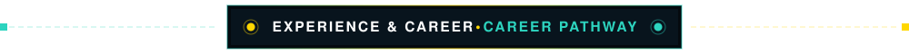

  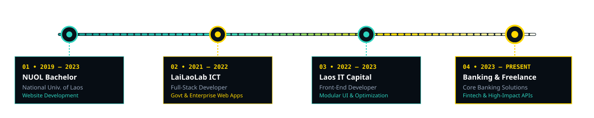

  

<!-- ═══════════════════════════ TECHNICAL ARSENAL ═══════════════════════════ -->

  

  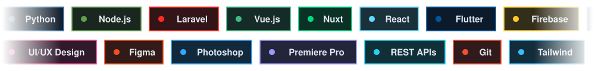

  

<!-- ═══════════════════════════ GITHUB METRICS & ACTIVITY ═══════════════════════════ -->

  

  

  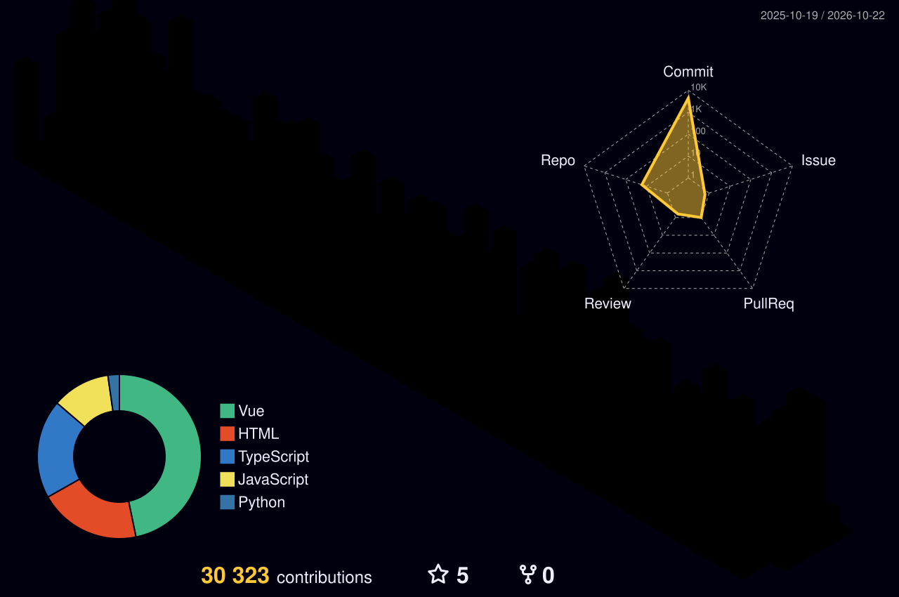

<!-- ═══════════════════════════ FEATURED PROJECTS ═══════════════════════════ -->

  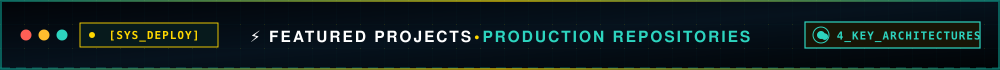

  

  &nbsp;&nbsp;
  &nbsp;&nbsp;
  &nbsp;&nbsp;
  

<!-- ═══════════════════════════ CONNECT & CONTACT ═══════════════════════════ -->

  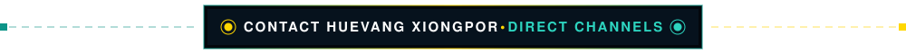

  

<!-- Contribution Snake -->

  <picture>
    <source media="(prefers-color-scheme: dark)" srcset="https://raw.githubusercontent.com/huevangxp/huevangxp/output/github-snake-dark.svg"/>
    <source media="(prefers-color-scheme: light)" srcset="https://raw.githubusercontent.com/huevangxp/huevangxp/output/github-snake.svg"/>
    
  </picture>

<h3 align="center">✨ "Excellence through clean architecture, continuous innovation & precision." ✨</h3>

<!-- ═══════════════════════════ FOOTER SKYLINE ═══════════════════════════ -->

  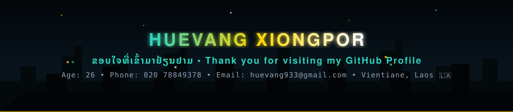

